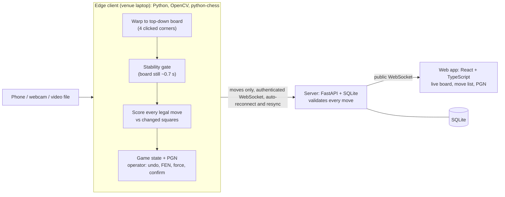

# ChessLens

Real-time digitization and live broadcast of physical chess games using computer vision.
Point an ordinary camera (a phone used as a webcam is enough) at a normal chessboard and get
moves, a PGN file and a live web page. No sensor board such as DGT is needed.

> Status: the whole pipeline works locally on synthetic footage (edge, server, web, tests,
> CI definition, Terraform). It has **not** been tried on a real board or a live camera yet,
> and the Docker images, GitHub Actions workflows and Terraform have never been run. See
> [Limitations](#limitations) and [Accuracy](#accuracy).

## How it works

The edge client does not recognise every piece in every frame. The starting position and the
rules of chess are known, so it only has to work out which **legal move** explains the change
between two still pictures of the board. If it cannot tell, it says "uncertain" and waits for
the operator instead of guessing.



Vision runs on the edge machine, not in the cloud. Only small move events leave the venue.

| Folder | What it is |
|---|---|
| `edge/` | Camera to moves: calibration, stability gate, move detector, operator controls, uploader, CLI |
| `server/` | FastAPI: game REST API, ingest and viewer WebSockets, rate limiting, JSON logs |
| `web/` | React + TypeScript (strict) + Vite spectator app, built to static files |
| `tests/` | Unit tests, synthetic footage generator, accuracy evaluation (synthetic and real) |
| `infra/` | Terraform for one small EC2 VM, alerts and GitHub OIDC deploy role |
| `docs/` | Accuracy, runbook, costs, roadmap, demo script, resume bullets |

## Quick start

Prerequisites: Python 3.11+, Node 20+ (22 used here), and optionally Docker Desktop.

```powershell
python -m venv .venv
.\.venv\Scripts\pip install -r requirements-dev.txt
cd web ; npm ci ; cd ..

# server (terminal 1)
$env:INGEST_TOKEN = "dev-token"
.\.venv\Scripts\uvicorn server.main:app_factory --factory --port 8000

# web (terminal 2), then open http://localhost:5173
cd web ; npm run dev

# play a synthetic game into it (terminal 3)
.\.venv\Scripts\python -m tests.make_video tests/games/italian_castling.pgn tests/fixtures/italian
.\.venv\Scripts\python -m edge run --source tests/fixtures/italian.mp4 --calibration tests/fixtures/italian.calibration.json `
  --server http://localhost:8000 --token dev-token --headless
```

With a camera: `.\.venv\Scripts\python -m edge calibrate --source 0`, then `... -m edge run --source 0 --server ...`.
Everything else (Docker Compose, operating the client, AWS deployment, teardown) is in
[docs/RUNBOOK.md](docs/RUNBOOK.md).

## Tests

```powershell
.\.venv\Scripts\python -m pytest -q            # Python unit and integration tests
.\.venv\Scripts\python -m tests.eval           # synthetic accuracy; fails below the threshold
cd web ; npm run lint ; npm test ; npm run build
python -m tests.eval_real                      # real footage, once you have recorded clips
```

## Accuracy

Numbers come only from the evaluation scripts and are never mixed.

- **Synthetic** (`python -m tests.eval`, 2026-10-19): 236 of 237 moves correct (99.6%) over 9
  simulated games with moving hands; 1 flagged uncertain, 0 silently wrong.
- **Real footage:** none evaluated yet.

Details, failure categories and caveats: [docs/ACCURACY.md](docs/ACCURACY.md). Synthetic data is
much easier than a real board, so the synthetic figure is not a claim about real-world accuracy.

## Limitations

- Not yet tested on a real board, real lighting or a live phone camera.
- Fixed camera only; if it moves, recalibrate. Overhead or steep angles work best; low angles
  where pieces hide each other are expected to be hard.
- Promotions default to queen; the operator must correct underpromotions.
- A hand resting on the board for a long time, or heavy glare, can cause "uncertain" or missed
  moves. After any mistake the operator can undo, force a move or type a position.
- One board per game and a shared ingest token: no user accounts, no multi-board tournaments.
- The deployed stack is plain HTTP on a single VM (the token is sent unencrypted); fine for a
  demo, not for production.
- Stockfish evaluation bar and automatic desync recovery are not implemented.

Full list of cut and deferred items: [docs/ROADMAP.md](docs/ROADMAP.md).

## Demo

Demo script: [docs/DEMO.md](docs/DEMO.md). Screenshots and a GIF go here once recorded:

- _demo GIF placeholder_
- _screenshot placeholder_

## License

MIT. See [LICENSE](LICENSE).
